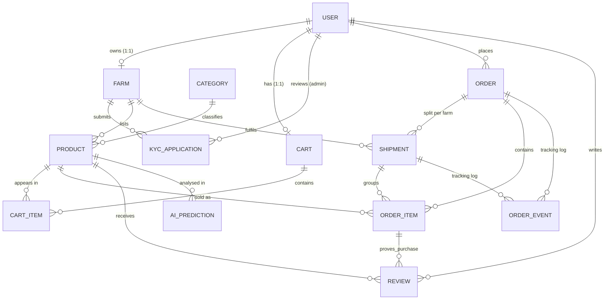

# Database schema

| Model | Purpose / key constraints |
|---|---|
| User | custom user, unique email, `role` ∈ farmer/customer/admin; superuser ⇒ admin |
| Farm | 1:1 User; public farm info; cached `kyc_status` |
| KYCApplication | one row per submission (history); stores last 4 ID chars; private file; `reviewed_by`, `reviewed_at`, `decision_reason` |
| Category / Product | Product→Farm & Category `PROTECT`; CHECK price>0, stock≥0; indexes (category,is_active), price |
| Cart / CartItem | Cart 1:1 User; UNIQUE(cart,product); CHECK quantity>0; no prices stored |
| Order | status (derived) + payment_status (cod_pending / cod_paid); `total_amount`; CHECK total≥0 |
| Shipment | one per farm per order (UNIQUE); own status, carrier, tracking no., timestamps |
| OrderItem | name/unit/price **snapshots**; CHECK quantity>0; Product `PROTECT` |
| OrderEvent | append-only tracking timeline (who/what/when) |
| Review | UNIQUE(user,product); CHECK rating 1–5; status published/hidden |
| AIPrediction | audit of predictions; predicted price kept apart from Product.price |

Many-to-many relations (Product↔Order, Product↔Cart) are modelled by the data-carrying join tables OrderItem and CartItem.
Normalization: farm and category data is stored once; denormalized snapshots (`unit_price`, `total_amount`) are intentional so history never changes.
Note: MySQL ignores conditional unique indexes, so "one pending KYC per farm" is enforced in `farms/services.py` rather than in the DB.
